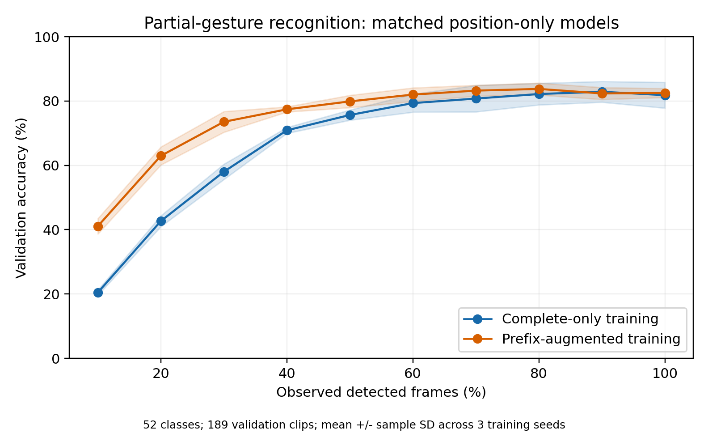

# Improving Real-Time Hand Gesture Recognition Using Spatially Normalized Landmarks and Temporal Motion Features

[AUTHOR NAME]

[SCHOOL AFFILIATION AND CONTACT INFORMATION]

> Manuscript draft updated with 18 completed training and validation runs: six configurations across three seeds. The new ablation results are validation measurements, not final test-set or live-webcam estimates. Supporting data and the reproducible aggregation are in [the experiment summary](experiments/report_data/ABLATION_RESULTS.md). The development history is preserved in [JHSS_DEVELOPMENT_RECORD.md](JHSS_DEVELOPMENT_RECORD.md).

## Abstract

Real-time hand gesture recognition requires decisions before a gesture is complete, while training commonly uses full recordings. This study examined how landmark features and partial-sequence training affect recognition under incomplete temporal input. A bidirectional long short-term memory network with attention and masked pooling was trained on 770 isolated-sign sequences spanning 52 classes. Six configurations were evaluated on 189 validation clips across three random seeds, producing 18 completed runs. Prefix augmentation increased position-only accuracy at 10% gesture completion from 20.46% to 41.09%, a mean gain of 20.63 percentage points. At completion, mean accuracy was similar: 81.83% for complete-only training and 82.54% with prefix augmentation. Positions with frame differences achieved the highest mean full-sequence accuracy, 83.25%, compared with 81.83% for positions alone, 79.19% for scale-normalized positions, 76.19% for positions with stored motion, and 71.43% for the legacy representation. These results suggest that explicit exposure to partial gestures improves early classification, while additional normalization and motion channels do not uniformly improve performance. Because checkpoints were selected using this validation set, the findings are exploratory. Independent test-set confirmation and labeled live-webcam evaluation are required to establish deployment accuracy and latency.

Keywords: hand gesture recognition, spatial normalization, temporal motion features, incomplete sequences, real-time inference, hand landmarks, isolated sign recognition

## 1. Introduction

Recognizing a gesture from a completed video and recognizing it during performance are different prediction tasks. A complete recording contains the hand shapes, transitions, and movements that distinguish a gesture. A live system initially observes only a prefix. Several gestures may share an initial posture and become distinguishable only after additional movement. An accurate offline classifier can consequently make incorrect early predictions during webcam deployment.

This project aims to build a hand gesture recognition model and improve its real-time accuracy. The application classifies isolated American Sign Language (ASL) signs from hand landmarks. Sentence recognition and translation are outside the scope of the study.

The primary research question is: **How can real-time gesture recognition systems be designed to maintain accuracy despite incomplete temporal input?** Two supporting questions guide the feature and model experiments: **How do spatial normalization and temporal motion features affect the accuracy of hand landmark-based gesture recognition?** and **What preprocessing and temporal modeling strategies improve robustness in landmark-based gesture recognition systems?**

The working hypothesis is that informative spatial and motion features, exposure to partial gestures during training, and a suitable prediction policy can improve recognition before a gesture is complete. Early recognition nevertheless has an information limit: classes with indistinguishable prefixes cannot always be separated before their distinguishing motion occurs. A system must balance immediate feedback with waiting for evidence or returning an uncertain result.

The completed study compares landmark representations and prefix augmentation using a common temporal architecture, dataset, and optimization protocol. It measures classification at successive fractions of a gesture. Accuracy-versus-wall-clock-latency analysis remains future work because the cached sequences do not retain original capture timestamps.

## 2. Related Work

### 2.1 Hand landmarks

MediaPipe Hands provides a pipeline for estimating a hand skeleton from RGB camera input (1). Landmarks allow a separate classifier to operate on hand geometry instead of every image pixel. This study uses that representation as a compact input, while evaluating the consequences of spatial transformations and tracking errors.

### 2.2 Temporal modeling

Long short-term memory (LSTM) networks were introduced to address difficulties in learning dependencies over time (2). The present model combines recurrent layers with multi-head attention, following the general attention mechanism described by Vaswani et al. (3). These established components provide the temporal model; the study does not claim a new recurrent or attention architecture.

A bidirectional model can use all frames within the supplied prefix, but cannot access frames that have not arrived. Repeated prefix classification supports live inference, although its computational cost differs from a causal model that updates its hidden state once per frame.

### 2.3 Isolated-sign recognition

ASL Citizen contains 83,399 videos covering 2,731 signs performed by 52 signers (4). The present ablations used a fixed 52-class subset, with 770 training and 189 validation sequences. An earlier checkpoint was separately evaluated on 651 matching test clips. The 52-class vocabulary and the dataset's 52 signers are distinct quantities. Isolated-sign recognition is a limited task and should not be presented as continuous ASL understanding.

This study focuses on recognition from partial observations and its dependence on feature representation. Published complete-video results are comparable only when vocabulary, splits, and metrics match.

## 3. Methodology

### 3.1 Landmark extraction

MediaPipe extracts 21 landmarks per detected hand, each with three coordinate values. The shared Python feature builder assigns detections to explicit right-hand and left-hand slots using handedness labels. Binary presence flags indicate whether each hand is detected.

All six configurations used the same cached detections and original feature ordering. Their completed-run settings confirm identical training and validation sample-ID hashes and the same feature-construction source hash. Recorded/live preprocessing equivalence remains a deployment check; no new webcam evaluation was included in the suite.

### 3.2 Spatial normalization

The implemented representation subtracts the wrist position from each hand landmark:

`r[h,j,t] = p[h,j,t] - p[h,0,t]`

Here, h denotes the hand, j the landmark, t the timestep, and landmark 0 the wrist. Wrist centering reduces dependence on an individual hand's position in the image while retaining local shape. It also removes absolute wrist position from the position block. The audit confirmed that wrist position channels were zero in all selected cached sequences. Raw-coordinate and global/inter-hand-position comparisons were not performed because those positions are absent from the cache; they require re-extraction from the available original videos.

The completed scale-normalization condition divided each hand's relative positions by the per-frame Euclidean norm of its wrist-relative middle-finger metacarpophalangeal coordinate (landmark 9), bounded below by 1e-6. No temporal smoothing was applied. This transform used only the current observed frame. Image-normalized coordinates and normalization by hand size are distinct operations; this experiment tested only the additional hand-scale transform, not raw coordinates versus wrist centering.

### 3.3 Temporal motion features

For non-wrist landmarks, the builder calculates timestamp-normalized motion from wrist-relative positions:

`v[h,j,t] = (r[h,j,t] - r[h,j,t-1]) / elapsed_seconds`

In the shared builder, wrist motion uses absolute wrist coordinates, preserving translation information despite its zero relative position. The first observation and invalid timestamp intervals produce zero motion. This defines intended coordinate change per second, not physical velocity in meters per second. The experiments reused previously stored motion channels rather than recomputing them from source timestamps. Their original unit convention has not been independently verified, so the results refer to **stored motion**, not validated physical or timestamp-normalized velocity.

The legacy schema has 255 raw values per frame: a frame index, two presence flags, and 21 landmarks times six position/motion values for each of two hands. Appending frame differences across all raw channels produces 510 inputs. The added differences include changes in the frame index, presence flags, and stored motion; all 510 channels should not be described as landmark velocity.

Feature-only conditions reserved a zero value at column 0, retained presence at columns 1 and 2, and excluded the capture index from learned inputs. Position-only and scaled-position inputs contained 129 channels. Adding either frame differences or stored motion produced 255 channels. Frame differences were computed after truncating to the observed prefix, and motion channels were zeroed on the first timestep and where a hand was absent or newly present. Gaps where neither hand was detected had already been removed from the cached arrays and cannot be reconstructed from their contiguous indexes.

### 3.4 Presence masking and sequence handling

Absent-hand slots contain zeros and false presence flags. Frames containing neither hand are excluded from the classifier sequence and can instead signal gesture completion. Observed sequences retain their lengths; batches are padded only to their longest sequence, replacing the earlier fixed 93-frame requirement.

The classifier derives a timestep mask from presence flags, packs recurrent inputs, excludes padding from normalization and attention, and pools valid outputs. Packed recurrence assumes valid timesteps precede trailing padding, so internal all-absent frames must be removed or treated through a different representation. Hand presence and padding validity should be documented separately.

Temporal resampling and sliding windows are planned experiments. They should not be claimed as implemented contributions until evaluated. Resampling can change motion timing, while a sliding window can discard early context.

### 3.5 Model architecture and training

The inspected PyTorch model has two bidirectional LSTM layers with 128 and 64 hidden units per direction, producing 256- and 128-dimensional outputs. Each is followed by masked batch normalization and dropout of 0.3. A four-head attention block includes residual connections, layer normalization, a feed-forward width of 128, and residual-branch dropout of 0.1.

Masked mean pooling produces one sequence representation. The classifier contains a 64-unit ReLU layer, dropout of 0.2, and one output logit per class. Softmax scores are generated during inference.

All 18 completed runs started from scratch and used cross-entropy loss, Adam at learning rate 0.001, batch size 32, gradient clipping at norm 1.0, a maximum of 150 epochs, and patience 15. The checkpoint with the lowest complete-sequence validation loss was selected in every condition. Seeds were 17, 42, and 73, with one run per seed and configuration. Training used PyTorch 2.13.0+cu130 on an NVIDIA GeForce RTX 5070; exact GPU determinism was not guaranteed.

### 3.6 Real-time inference

The current application accumulates detected frames and begins provisional predictions after eight frames. It finalizes after eight consecutive empty landmark messages. This message-count rule has a variable elapsed duration when sampling frequency changes. A time-based policy is a planned comparison.

The current confidence threshold of 0.8 is a development setting. Final thresholds must be chosen on validation data. Candidate policies include minimum observation duration, sustained prediction agreement, inactivity finalization, and rejection of uncertain input. Empty frames can signal completion without being appended to the classifier input.

## 4. Experiments

The completed suite comprised six configurations across three seeds: five feature representations and a position-only prefix-training condition. Runnable commands are in [the Section 4 runbook](experiments/SECTION4_RUNBOOK.md); computed tables and per-seed results are in [the experiment summary](experiments/report_data/ABLATION_RESULTS.md). The checkpoint filename says "fifty words," but its embedded vocabulary and all 18 ablations contained 52 classes.

An [inventory of experiments using existing data](experiments/EXISTING_DATA_EXPERIMENTS.md) distinguishes cached-feature experiments from new extraction using the original videos already on disk. The audited 52-class subset contains 770 training, 189 validation, and 651 test sequences. Official source manifests have disjoint signer groups; exact feature-content matching verifies source identities for 1,394 of the 1,610 cached sequences. The remaining 216 associations must be recovered before claiming verified signer provenance for the entire cached subset.

### 4.1 Evaluation protocol

Every completed run used the same frozen ordered vocabulary, 770 training clips, and 189 validation clips, without subsampling. The selected cache included 12–18 training and 3–5 validation clips per class. Training lengths ranged from 2 to 312 detected frames (median 29); validation lengths ranged from 6 to 91 (median 30). The official source splits used disjoint signer groups, but only 1,394 of 1,610 cached train/validation/test sequences could be linked exactly to currently available source CSVs. Verified source-link coverage was 664/770 for training and 163/189 for validation. This prevents a fully verified signer-level analysis of the complete cache.

All prefixes remained within the original clip's split. Each configuration was trained with seeds 17, 42, and 73, and selected by complete-sequence validation loss. The suite did not load or score the test set. Model selection and the reported ablation metrics used the same validation clips, so the comparisons are exploratory rather than unbiased generalization estimates. Failed infrastructure attempts were excluded; completed results were preserved, and checkpoint/status-I/O amendments were recorded without changing the feature or training protocol.

### 4.2 Normalization impact

The completed normalization experiment compared wrist-centered positions with the same positions divided by the hand-scale measure defined in Section 3.2. Both inputs had 129 channels and 542,068 trainable parameters. Each variant was retrained and evaluated on identical clips and prefixes. Raw coordinates and location-preserving representations remain untested; the completed comparison cannot establish whether wrist centering itself improves recognition.

### 4.3 Motion-feature impact

The completed motion comparison included positions alone (129 channels), positions plus causal frame differences (255), positions plus stored motion (255), and the legacy representation (510). Capture indexes were excluded from feature-only conditions. The 255-channel models each had 671,092 trainable parameters, while the legacy model had 932,212. Hidden-layer sizes were fixed, so varying input dimensions changed capacity. Legacy-versus-feature-only comparisons also changed metadata inclusion, channel ordering, and motion construction; their accuracy difference cannot be attributed solely to one feature type.

Class-group analyses and controlled frame-rate reduction were not included. They require a prespecified grouping protocol and, for timing-aware comparisons, richer extraction from the original videos.

### 4.4 Sequence length and temporal model

All completed runs used the same variable-length BiLSTM/attention architecture with dynamic batch padding. Fixed-duration resampling and sliding-window comparisons remain future work.

Pooled non-recurrent baselines, unidirectional recurrence, and attention removal were not tested. Consequently, the completed data do not isolate the contribution of bidirectionality or attention. Epoch durations were logged, but they are not batch-1 inference or end-to-end webcam latency measurements.

### 4.5 Prefix versus full-sequence recognition

For each validation clip containing T valid frames, evaluation used its first `ceil(q*T)` frames for completion fractions q = 0.1, 0.2, ..., 1.0, retaining at least one frame. Feature construction followed truncation, without future-frame access. All configurations used identical clips and completion fractions.

The matched training comparison used the 129-channel position representation in both conditions. Complete-only training retained each entire clip. With prefix augmentation, each sample presentation had probability 0.5 of selecting a prefix length uniformly from 1 through T; otherwise the whole sequence was retained. A selected prefix inherited the original clip's label, even when early observations could be ambiguous. Validation and checkpoint selection still used complete sequences in both conditions. Initialization, architecture, optimizer, data, and seeds were held constant within each comparison; GPU execution was not guaranteed bitwise deterministic.

Accuracy and macro F1 were recorded at every completion fraction. Percentage completion is an offline reference based on detected-frame count, not elapsed time. A deployed system does not know final gesture duration in advance. No wall-clock decision times were measured.

### 4.6 Live prediction policies

No labeled live-session policy experiment was performed. The earlier checkpoint's fixed-threshold accuracy/coverage diagnostic is reported separately in Section 5.2 and is not evidence for a calibrated live decision policy.

Future work should compare unconditional prediction, minimum observation duration, calibrated confidence rejection, temporal agreement, and time-based finalization using labeled sessions. Accepted accuracy must be accompanied by coverage. Actual capture/transport delay, unknown-gesture false activations, and boundary errors require a separate evaluation.

### 4.7 Metrics and statistical analysis

Per-run outputs contain training histories, prefix and complete-sequence accuracy, top-5 accuracy, macro and weighted F1, per-class precision/recall/support, confusion matrices, and clip-level predictions. The manuscript summarizes mean accuracy and macro F1 across three training seeds. All 52 classes had validation support.

The reported dispersion is sample standard deviation across the three seeds (denominator n-1). It is not a signer-clustered confidence interval or a significance test. Repeated seeds reuse the same 189 clips, so they do not constitute 567 independent evaluation clips. Paired prefix-training gains were calculated within each seed on identical clips and then averaged. The aggregation verifies common sample-ID hashes, feature-construction source, class support, and per-run summary values. Final held-out and clustered comparisons remain outstanding.

## 5. Results

### 5.1 Completed-run accounting

The suite completed 18 runs: six configurations across seeds 17, 42, and 73. Every reported ablation used all 770 matching training clips and all 189 matching validation clips. Failed attempts and small smoke tests were excluded. Training/validation sample-ID hashes matched across runs. The aggregation used stored summaries and checkpoint-selection records without evaluating new models on test clips.

Historical measurements from an earlier model, including the previously quoted 89.03% accuracy, are retained only in the development record. They are not evidence for the present configurations.

### 5.2 Earlier-checkpoint reference: validation and test

Evaluation of `hand_gesture_modelv11_fifty_words.pt` used all 651 test clips matching its 52-class vocabulary and all 189 matching validation clips. The embedded class mapping matched the supplied parameters. Complete-sequence validation accuracy was 67.72%, reproducing the checkpoint's stored value; complete-sequence test accuracy was 59.29%, with macro F1 of 0.5883.

| Detected-frame completion | Test accuracy | Macro F1 |
|---|---:|---:|
| 10% | 4.76% | 0.0297 |
| 30% | 22.43% | 0.2205 |
| 50% | 41.01% | 0.3945 |
| 70% | 56.99% | 0.5627 |
| 80% | 59.29% | 0.5846 |
| 90% | 60.37% | 0.5979 |
| 100% | 59.29% | 0.5883 |

These measurements describe the earlier checkpoint, not the 18 newly trained ablation models. They are not live-webcam results. Accuracy is not strictly increasing with context: the 90%-to-complete difference is a net seven clips and does not establish a significant truncation benefit. Completion fractions count detected frames, not elapsed time. Do not interpret a difference between this checkpoint's 59.29% test accuracy and a new model's validation accuracy as a test-set improvement.

At the existing threshold of 0.8, complete-sequence accepted accuracy was 86.88% at 33.95% coverage; overall accuracy remained 59.29%. Thresholds were not tuned on these test results. Detailed per-class metrics, confusion matrices, predictions, source hashes, and paired correctness changes are available in [the result archive](experiments/results/v11_52classes_test/manifest.json).

### 5.3 Feature representations: complete-sequence validation

Table 1 reports mean +/- sample standard deviation over the three training seeds. Accuracy standard deviations are in percentage points. All conditions used the same recurrent/attention hidden-layer settings, but their input dimensions and parameter counts differed.

| Configuration | Parameters | Complete accuracy (%) | Complete macro F1 | Accuracy at 50% completion (%) |
|---|---:|---:|---:|---:|
| Legacy features | 932,212 | 71.43 +/- 2.31 | 0.7024 +/- 0.0257 | 56.79 +/- 4.28 |
| Wrist-centered positions | 542,068 | 81.83 +/- 4.01 | 0.8094 +/- 0.0372 | 75.66 +/- 1.59 |
| Scale-normalized positions | 542,068 | 79.19 +/- 3.52 | 0.7811 +/- 0.0373 | 73.02 +/- 4.61 |
| Positions + frame differences | 671,092 | 83.25 +/- 2.39 | 0.8221 +/- 0.0277 | 76.19 +/- 1.91 |
| Positions + stored motion | 671,092 | 76.19 +/- 3.17 | 0.7529 +/- 0.0245 | 68.78 +/- 2.31 |
| Positions + prefix training | 542,068 | 82.54 +/- 1.40 | 0.8083 +/- 0.0271 | 79.89 +/- 1.91 |

Positions with frame differences had the highest mean complete-sequence accuracy (83.25%) and macro F1 (0.8221). Its mean accuracy exceeded positions alone by 1.41 percentage points, but not in every seed. Positions alone exceeded the legacy representation by 10.41 points on average. That comparison changed several aspects of the input and model capacity; it does not isolate capture-index removal or motion encoding as the sole cause.

Additional hand-scale normalization reduced mean complete accuracy by 2.65 percentage points relative to wrist-centered positions and was lower in all three seed comparisons. Stored motion reduced it by 5.64 points relative to positions alone. These results apply to the particular transforms and cached motion used here; they do not establish that normalization or velocity features generally harm recognition.

### 5.4 Prefix augmentation: recognition before completion

The matched position-only comparison provides the clearest result for the primary research question. At 10% completion, prefix augmentation increased mean accuracy from 20.46% to 41.09%, a gain of 20.63 percentage points. The improvement was positive for all three seeds, ranging from 17.99 to 22.22 points. Gains were also positive for all seeds at 20% and 30% completion.

| Detected-frame completion | Complete-only training accuracy (%) | Prefix-augmented training accuracy (%) | Mean paired difference (percentage points) |
|---|---:|---:|---:|
| 10% | 20.46 +/- 0.81 | 41.09 +/- 2.39 | +20.63 |
| 20% | 42.68 +/- 1.70 | 62.96 +/- 2.80 | +20.28 |
| 30% | 58.02 +/- 2.39 | 73.54 +/- 3.22 | +15.52 |
| 50% | 75.66 +/- 1.59 | 79.89 +/- 1.91 | +4.23 |
| 90% | 82.89 +/- 3.23 | 82.36 +/- 1.86 | -0.53 |
| 100% | 81.83 +/- 4.01 | 82.54 +/- 1.40 | +0.71 |

The largest gains occurred early and narrowed as the gesture became complete. At 90%, augmented training was slightly lower on average. At completion, mean accuracy was similar, but per-seed changes ranged from -3.70 to +5.82 points. Thus the results do not prove that prefix augmentation preserves final accuracy for every training run or satisfies a formal non-inferiority criterion. Complete-sequence macro F1 was also slightly lower on average with augmentation (0.8083 versus 0.8094).

Figure 1. Lines show mean accuracy over seeds 17, 42, and 73 on the same 189 validation clips. Shaded regions show one sample standard deviation across seeds; they are not confidence intervals. Full ten-point curves, individual-seed results, and input hashes are provided in [the computed supplement](experiments/report_data/ABLATION_RESULTS.md) and [machine-readable summary](experiments/report_data/ablation_summary.json).

### 5.5 Completed and outstanding evidence

| Question | Completed evidence | Remaining work |
|---|---|---|
| Additional hand-scale normalization | Three-seed centered-versus-scaled comparison | Raw/global coordinates and independent test confirmation |
| Explicit motion features | Position, difference, stored-motion, and legacy comparisons | Motion provenance, frame-rate controls, class-group analysis |
| Partial-gesture training | Matched complete-only/prefix comparison over ten completion fractions | Final held-out evaluation and labeled webcam sessions |
| Sequence strategy and architecture | Variable-length BiLSTM/attention used in every run | Window, resampling, pooling, recurrence, and attention ablations |
| Live prediction policy | Earlier fixed-threshold diagnostic only | Calibration, coverage/latency policies, and boundary evaluation |

All 18 planned suite runs are complete. This does not mean every broader experiment proposed in Section 4 has been performed, or that a new model has been deployed to the website.

## 6. Discussion

The completed ablations address the feature representation and exposure to incomplete input during training. Their results support an exploratory design conclusion about early recognition, while architecture, timing, and live decision-policy questions remain open.

### 6.1 Learning from complete gestures but predicting partial gestures

Complete-sequence training optimizes classification using evidence that may be absent from a live prefix. Variable-length input support alone does not train a model to recognize incomplete gestures: it only permits sequences of different lengths. The matched experiment supports explicitly including incomplete observations during training. Prefix augmentation more than doubled mean accuracy at 10% completion and improved it by 15.52 percentage points at 30%, while mean completed-gesture accuracy remained close to the complete-only condition.

Early accuracy nevertheless remained only 41.09% at 10% completion. Augmentation reduces the mismatch between training and partial-input evaluation but does not supply missing distinguishing evidence. Some prefixes may remain ambiguous, requiring additional observation or an uncertain output. Class-specific shared-prefix analysis is needed to separate ambiguity from model errors.

### 6.2 Spatial invariance versus preservation of discriminating information

Wrist centering reduces dependence on image translation, but independent centering also removes absolute hand location and the spatial relationship between the hands. These may distinguish otherwise similar gestures. Hand-scale normalization can reduce camera-distance variation while introducing noise from the scale estimate. The representation must preserve task-relevant geometry while reducing irrelevant variation.

In the completed comparison, the additional hand-scale transform reduced mean accuracy from 81.83% to 79.19%, with a reduction in every seed. Possible explanations include removal of useful size-related cues or noise from the per-frame scale estimate, but the experiment did not isolate those mechanisms. Since all feature-only conditions were already wrist-centered, the result does not test the benefit of wrist centering itself. Global/inter-hand geometry remains a separate unperformed comparison.

### 6.3 Motion information versus sensitivity to measurement noise

Motion features can separate similar hand shapes with different trajectories. However, numerical differences also amplify landmark jitter, and differentiation over a short timestamp interval can produce large values from a small positional error. Detection gaps further complicate interpretation of a trajectory.

Frame differences produced a modest mean full-sequence gain over positions alone (1.41 percentage points), whereas stored motion performed worse by 5.64 points. Position-only models still used recurrence and attention, so they could learn temporal relationships without explicit motion channels. The findings favor evaluating the quality and scaling of a motion representation rather than assuming that additional derivative channels are beneficial.

The stored-motion and frame-difference models had the same parameter count, making their 7.05-point mean accuracy difference a useful representation comparison. However, they differed in motion definition, included wrist-motion information, and possibly scale/provenance. The results do not isolate timestamp normalization as the cause. Controlled re-extraction and sampling-rate experiments are needed to investigate those mechanisms.

### 6.4 Temporal context versus computation and information loss

Accumulating the entire observed gesture preserves context, but repeated BiLSTM and attention evaluation increases computation as the prefix grows. A sliding window bounds the input while potentially discarding an early movement needed to identify the sign. Resampling standardizes length while potentially obscuring motion duration and timing. Masked mean pooling may also dilute a brief discriminating event among many less informative frames.

Sequence-handling and architecture comparisons were not included in the 18-run suite. Future comparisons should measure accuracy and execution time together, particularly for long-range context and brief discriminating movements. The present data cannot establish whether a causal model, window, or different pooling strategy would outperform full-prefix recomputation.

### 6.5 Early decisions versus reliable final predictions

Waiting for completion can increase final accuracy without improving recognition of partial input. A high confidence threshold or a stability rule can suppress errors while increasing delay and reducing coverage. Stable predictions can also remain consistently wrong.

The prefix-training benefit was measured at identical completion fractions without adding a rejection policy, so it reflects better recognition at the same observed-frame budget rather than simply waiting longer. This is an offline input-efficiency result, not a measured reduction in milliseconds. At 90% completion the mean augmentation effect was slightly negative, and at 100% it varied by seed; more input did not guarantee a monotonic improvement for every configuration.

Calibrated acceptance policies may complement prefix training, but their accuracy, coverage, and delay have not yet been evaluated for the new models.

### 6.6 Gesture boundaries versus temporary detection loss

Missing hands may indicate the end of a gesture, occlusion, tracking failure, or a movement outside the camera view. A rule that equates every sufficiently long detection gap with completion may split one gesture into multiple predictions. Conversely, gestures that end while hands remain visible may never trigger that rule.

Evaluate end-detection errors separately from classification errors. Compare inactivity and motion-based policies on labeled boundaries, including gestures with internal pauses and temporary occlusion. Boundary design affects the temporal evidence supplied to the model and therefore belongs in the recognition study.

### 6.7 Limitations and interpretation of contributions

The principal limitation is that the 189 validation clips were used both to select checkpoints and to compare the configurations. The reported ablations are exploratory validation findings. The earlier checkpoint's test results cannot substitute for test evaluation of the newly trained models. Three seeds quantify training variation on the same clips, not population uncertainty, and no significance or non-inferiority claim is made.

The cached subset has a small vocabulary and limited support per class. Source signer groups are disjoint, but 216 cached source associations remain unresolved. Stored motion provenance is incomplete, and input dimensions change the first recurrent layer's parameter count. Legacy-versus-clean comparisons also alter metadata channels and feature construction. These limitations restrict causal attribution to individual preprocessing choices.

Standard recurrent and attention components do not establish architectural novelty. The demonstrated contribution is a controlled validation comparison of feature representations and partial-input training, with clear separation from untested deployment and architecture claims.

Hand landmarks omit facial expression, body posture, and other information relevant to ASL. The application recognizes isolated signs rather than sentences. Generalization requires a labeled live dataset with held-out signers or sessions, and uncertainty thresholds require validation and calibration.

## 7. Conclusion

Eighteen completed runs indicate that training with partial gestures can improve recognition under incomplete temporal input. For matched position-only models, mean validation accuracy increased from 20.46% to 41.09% at 10% completion, while completed-gesture accuracy remained similar on average. Positions plus frame differences achieved the highest mean full-sequence accuracy (83.25%); additional hand-scale normalization and the stored-motion representation did not improve over positions alone. The findings support prefix exposure during training and empirical feature ablation as practical design strategies. They do not yet establish held-out or real-time webcam performance. Final test evaluation, richer provenance, and labeled live sessions are required before drawing deployment conclusions.

## Statements and reproducibility information

**Data availability:** ASL Citizen is available from its [official project page](https://www.microsoft.com/en-us/research/project/asl-citizen/). The suite used the frozen 52-class vocabulary in its parameters file, 770 cached training clips, and 189 cached validation clips. The earlier-checkpoint test reference used 651 matching test clips. No new webcam recordings were collected. Dataset version and public archive details remain to be completed by the author.

**Code availability:** The local suite retains frozen source files, ordered labels, per-run settings, histories, checkpoint pointers, validation outputs, and source-hash amendments. Compact aggregate data and input hashes are in [ablation_summary.json](experiments/report_data/ablation_summary.json); [summarize_suite.py](experiments/summarize_suite.py) regenerates the tables and figure. [Provide a public versioned repository/archive before submission.]

**Experimental settings:** Python 3.12.10; PyTorch 2.13.0+cu130; NVIDIA GeForce RTX 5070; seeds 17/42/73; batch size 32; Adam learning rate 0.001; gradient clipping 1.0; up to 150 epochs; patience 15; selection by lowest complete-sequence validation loss. The supplement reports selected epochs and all individual-seed full-sequence accuracies. Exact GPU determinism was not guaranteed.

**Human participants:** This suite reused existing dataset recordings and collected no new participant recordings. [Complete the applicable data-use and ethics declaration for submission.]

**Author and mentor contributions:** [State each contributor's actual role.]

**Conflicts of interest:** [Complete the declaration.]

**AI assistance:** OpenAI Codex assisted with drafting and organization using the project history and inspected source files. The author is responsible for verifying methods, references, measurements, and final prose.

## References

1. Zhang, F., Bazarevsky, V., Vakunov, A., Tkachenka, A., Sung, G., Chang, C.-L., et al. (2020). *MediaPipe Hands: On-device real-time hand tracking*. arXiv. https://doi.org/10.48550/arXiv.2006.10214

2. Hochreiter, S., & Schmidhuber, J. (1997). Long short-term memory. *Neural Computation, 9*(8), 1735–1780. https://doi.org/10.1162/neco.1997.9.8.1735

3. Vaswani, A., Shazeer, N., Parmar, N., Uszkoreit, J., Jones, L., Gomez, A. N., et al. (2017). Attention is all you need. *Advances in Neural Information Processing Systems, 30*. https://arxiv.org/abs/1706.03762

4. Desai, A., Berger, L., Minakov, F. O., Milan, V., Singh, C., Pumphrey, K., et al. (2023). ASL Citizen: A community-sourced dataset for advancing isolated sign language recognition. *Advances in Neural Information Processing Systems, 36*. https://papers.nips.cc/paper/2023/file/f29cf8f8b4996a4a453ef366cf496354-Paper-Datasets_and_Benchmarks.pdf
